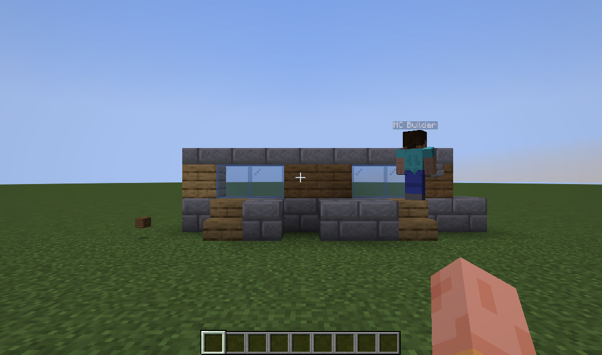

# Minecraft AI Builder

用 Minecraft 方块坐标、注册 ID 和状态描述建筑，支持在 Blender 里审阅模型，并通过 Forge Bridge 让 Fake Players NPC 在游戏里施工。

M1 在 Minecraft Java 1.20.1 和 Forge 47.4.20 中实测完成了 30 块窗墙。Python 提交施工计划，NPC 寻路并使用库存中的物品逐块放置。Bridge 提供进度查询、暂停、恢复、取消和完工回读。

M2 支持同一个 NPC 在施工中暂停并审阅新版本。批准后执行真实拆换与补建，保存重开后检查世界和库存再恢复。

## Windows 双击启动

双击 **Start MC AI Builder.cmd**，等隔离 Minecraft 练习世界与 Agent 显示已连接。用 `@Builder` 发送需求，或按 **Alt+B** 开启对话模式。建筑预览和审批会在游戏聊天中显示。 [三步体验指南](docs/m5-a-guide.md) · [验收记录](docs/m5-a-validation.md)

在启动器点 **选择世界** 可复制现有 BMC4 单人存档。进入 D 盘副本后，用游戏命令批准施工区、NPC 出生点、建筑原点和供料箱。 [真实世界副本指南](docs/m5-b-guide.md) · [真实地形验收记录](docs/m5-b-validation.md)

M6 支持 NPC 第一人称主动观察及施工复查。使用 `/architect survey` 根据地形设计，或用 `/architect supervise` 在半程、异常和完工时复查。模型发出的修改候选仍需在游戏中批准。 [M6 游戏内体验指南](docs/m6-guide.md) · [施工闭环验收](docs/m6-d-validation.md)

M7-A 支持带入口、窗组、屋顶和简单家具的三维单层住宅。使用 `/architect survey` 把现场地形和 NPC 视野纳入布局选择，并在 Blender 审阅外观与室内剖视。 [住宅体验指南](docs/m7-a-guide.md) · [验收记录](docs/m7-a-validation.md)

M7-P 改进住宅的连续施工和分批供料。启动器可选开启并行规划，让 Codex 在 NPC 施工期间观察现场并调整下一个已批准的屋顶工作组。 [性能测量](docs/m7-p-profiling.md) · [对照验收](docs/m7-p-validation.md)

施工 NPC 可由授权玩家用 `/architect observe` 观察第一人称视角。图像与姿态元数据保存到本地缓存，并与同一观测 ID 的局部 Forge 样本配对。 [NPC 观测说明](docs/m6-a-validation.md) · [视觉与世界状态](docs/m6-b-validation.md)

## 快速验证

在 Windows 的仓库根目录运行。准备 Python 3.13、Java 17 JDK 和已经安装的 PCL Forge 1.20.1 实例。将 `$instance` 设为该实例的版本目录。

~~~powershell
py -3.13 -m venv .venv
$instance = '<PCL 的 BMC4 版本目录>'
& .\tools\m1.ps1 Build
& .\tools\m1.ps1 Smoke -SourceInstance $instance
& .\tools\m1.ps1 M2Smoke -SourceInstance $instance
~~~

首次构建会下载 Gradle、Forge 开发依赖和 Fake Players 3.0.0。脚本用本机的 Minecraft 运行库在 `mc-test` 下创建独立测试世界，保存截图、逐块结果和游戏日志。

- [详细运行说明、手动演示和 Blender 流程](docs/README.md)
- [执行机制、游戏内验收和 BMC4 隔离复测](docs/m1-validation.md)
- [样例建筑数据](projects/m1_wall/building.json) · [施工计划](projects/m1_wall/construction-plan.json)
- [M2 动态修改与施工协调计划](docs/m2-plan.md)

- [M2 游戏内验收](docs/m2-validation.md) · [窗墙 V1/V2 样例](projects/m2_wall) · [施工差异报告](projects/m2_wall/change-example.json)
- [M3 任务规划](docs/m3-plan.md)

## 游戏内建筑师

M3 增加 `/architect`、独立 Python Runtime、参数化窗墙与游戏内审批。确定性后端可复现从设计到增量施工的流程。真实模型可用标准 HTTP 接口，或由官方 Codex SDK 复用本机 ChatGPT 登录。 [启动与体验](docs/m3-guide.md) · [验收与证据](docs/m3-validation.md) · [M4 规划](docs/m4-plan.md)

## 生存施工

M4 允许玩家批准实际供料箱，NPC 分批搬运并使用箱内物品施工。缺料、工具损坏和检查点冲突会暂停任务。BMC4 支持经过实测的 Chipped 与 Quark 建筑方块。 [启动与演示](docs/m4-guide.md) · [验收记录](docs/m4-validation.md)
