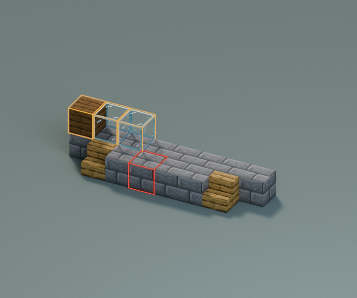
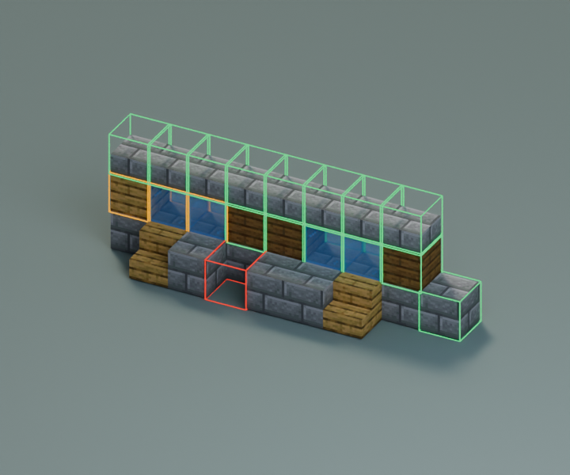

# M2 动态施工验收

环境为 Minecraft Java 1.20.1、Forge 47.4.20、Fake Players 3.0.0 和 Bridge 0.2.0。测试从独立超平坦世界起步，V1 复用 M1 窗墙。V2 将 4 块透明玻璃改为淡蓝染色玻璃，改用橡木端柱，去掉一块凸出的石砖，并向外补一块基础石砖。

## 最小 Forge 世界

| 验收 | 游戏内结果 |
| --- | --- |
| A 施工中途换版 | V1 放置 17/30 时提交候选并停止。审阅保留 13 格、补建 14 格、拆除 1 格、替换 3 格。未完成的旧目标按现场空气计入补建。提交审批哈希后同一 NPC 接管 V2。 |
| B 真实拆换 | 4 次 `ServerPlayerGameMode.destroyBlock` 各记录 1 次 Forge 左键事件和 1 次破坏事件。铁镐与铁斧每次耐久增加 1 点，石砖和云杉木板有实际掉落。17 次 `useItemOn` 各录得 1 次右键和 1 次放置事件、消耗 1 件对应物品，交互距离均在 4.5 格以内。 |
| C 玩家冲突 | 已登录测试玩家在 `(28, -60, 16)` 用游戏玩家交互放置圆石。旧审批返回 `review_changed`，刷新后返回 `change_conflicts`。拒绝候选再恢复时返回 `world_conflict`，圆石原位保留。补测在已批准拆换的空档放置圆石，恢复仍被拒绝，材料和工具耐久与断点一致。 |
| D 拆换中断 | 拆掉 `(8, -59, 6)` 的玻璃后暂停。客户端由 Minecraft 正常保存世界并退出。重开后相同 UUID、已完成步数、库存和工具耐久均与记录一致。显式恢复后该格只执行了待完成的放置，拆除动作保持一条。 |
| E 过期和重放 | 重交旧计划返回 `plan_already_used`。用新计划 ID 提交旧版本返回 `stale_version`。恢复已归档任务返回 `job_not_found`。同一批准请求重复发送时仍指向原 V2 任务。 |
| F 范围和终态 | 30 个目标的完整 ID、坐标和状态逐格匹配，已退出目标的位置为空气。扫描的 12,254 格非目标位置中包含批准范围外的一格边界 3,210 格，差异均为 0。 |

[真实差异和版本哈希](../projects/m2_wall/change-example.json) · [逐步操作、事件、材料和终态](m2-evidence/minimal.json) · [游戏内完工](m2-evidence/wall-v2.png)

## 三维审阅

用真实世界的差异报告生成 Blender 场景。两个视角使用同一相机与坐标。绿框为补建、橙框为替换、红框为拆除、紫框为冲突。生成命令见 [运行说明](README.md#m2-施工中途修改)。

| 现场 | 拟建 V2 |
| --- | --- |
|  |  |

## BMC4 隔离复测

独立测试目录复制了 387 个启用的 BMC4 JAR 和默认配置，并加载 Fake Players 与 Bridge。PackAnalytics 的出站发送在副本中关闭。首次重开时用 BCLib Guardian 的原生界面保留备份并继续。

同一个 NPC 在 V1 放置到 17 块时收到 V2，通过 4 次拆除和 17 次放置完成换版。测试中途保存在第一块玻璃已拆、替换未放的断点。重开检查世界、库存和工具后继续施工，V2 的 30 个目标逐格匹配，已拆除目标为空气，批准区边界的变化为 0。

另一面独立的 M1 回归墙在第一次保存前完成。重开后逐格检查仍是 30/30，一共跳过 30 个已有目标，放置和消耗均为 0。两次客户端退出码均为 0，Minecraft 日志都记录了完整维度保存。 [BMC4 逐步与重开证据](m2-evidence/bmc4.json)

## 恢复范围

每个游戏交互前持久化待执行步，交互结束后写入实际状态、事件、库存和进度。重开时核对现场和原 NPC，等待显式恢复。遇到未确认交互或世界存档与记录不同步时暂停并报告核对项。这一验收覆盖正常保存后的拆换断点，断电造成的未确认交互由上述保护停住。

拆除和放置沿用游戏玩家接口。施工调色板包括稳定的原版单块、干燥楼梯和台阶。修改依附于目标或会改变相邻敏感状态的情况会被约束。已存在且缺少 NPC 施工记录的块会受到保护。终态核对包括整个批准区域与一格边界。 [Forge 的玩家交互补丁](https://raw.githubusercontent.com/MinecraftForge/MinecraftForge/1.20.1/patches/minecraft/net/minecraft/server/level/ServerPlayerGameMode.java.patch)

**本地回归**　Forge Bridge 离线构建通过，14 个 Python 测试通过，M1 原版烟测通过。
