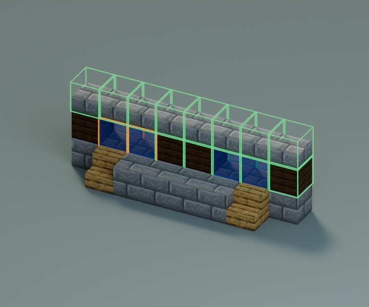
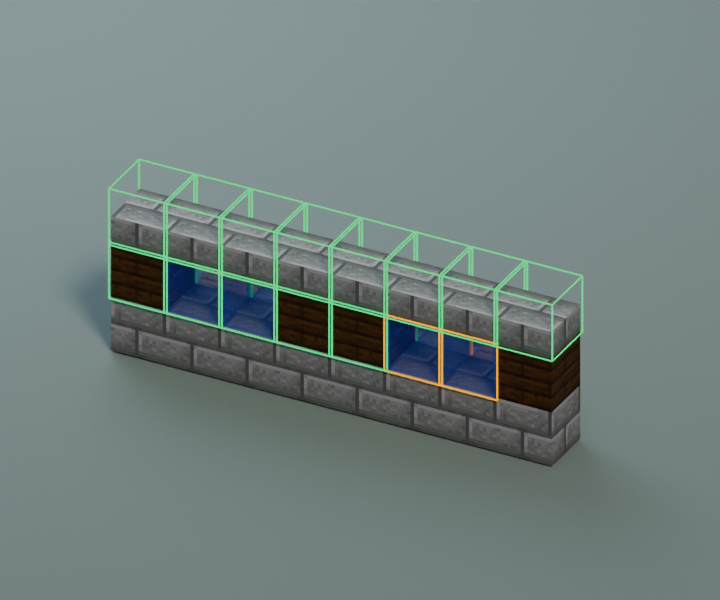

# M3 游戏内建筑师验收

已在真实 Minecraft Java 1.20.1、Forge 47.4.20、Fake Players 3.0.0 和 Bridge 0.3.0 中运行。独立 Python Runtime 分别用标准 HTTP 确定性夹具和真实 Codex Provider 验证。真实模型使用 ChatGPT 登录，通过官方 SDK 0.171.0 指定 `gpt-6.2-sol` 与 `medium`。 [Codex SDK 记录](m3-codex-sdk-validation.md)

## 真实 Codex 游戏内验收

| 用例 | 最小 Forge 隔离世界 |
| --- | --- |
| A 设计与改图 | 游戏内 `/architect` 请求经真实模型生成宽 8 格、高 3 格的中世纪窗墙，使用深色橡木、石砖和透明玻璃。第二次自然语言请求只把 4 个木板换成云杉，生成不同内容哈希。两份候选都提供材料摘要、Blender 工程和两角度图片，审批前无施工。 |
| B 玩家审批 | 玩家明确同意指定审阅，随后由获准的测试客户端发送原生 `/architect approve`。Forge 记录玩家、候选计划 ID 与审阅哈希。NPC 按 V2 逐块施工到 17/30，每次放置产生 Forge 右键和放置事件，并消耗一个物品。 |
| C 中途改图和终态 | Forge 收到明确暂停前缀时先停下旧队列。真实模型从整句需求解析出 V2 的局部改图，仅把玻璃改为蓝色染色玻璃。M2 对现场给出保留 15、补建 13、替换 2、冲突 0。再次批准后，同一个 Fake Player 通过 2 次工具拆除和 15 次真实放置完成 V3。30/30 坐标、ID、状态匹配，非目标及批准区域外差异均为 0。 |
| D 审批与回归 | 旧确认、重复确认和未授权身份均被拒绝。重放前后的施工记录、库存与工具相同。模型侧令牌尝试直接施工、批准或恢复都返回 401。针对 Codex Provider 注入超时、非法动作、非法方块和越界尺寸，Runtime 只回复错误提示。 |

首轮三个真实模型回合也完成了 30 个目标方块，并捕获玩家手动在范围外更换的两个岩浆块。Forge 正确返回 `world_verification_failed`。记录保留，随后在新隔离世界完整复测并通过。首次运行的 V2 初始审阅也通过正常保存和重开保留，原确认码仍可用。 [最小世界逐方块结果](m3-evidence/codex-minimal.json) · [首轮范围检查证据](m3-evidence/codex-scope-rejection.json)

真实 V3 的 `.blend` 由 Blender 后台重新打开核对。现场为 17 块，拟建为 30 块，两场景绑定同一审阅哈希，拟建场景有两个相机。原工程和图片保存在本机隔离运行目录。 [V3 正侧](m3-evidence/codex-proposed.png) · [V3 后侧](m3-evidence/codex-proposed-rear.png)

### 真实模型的 BMC4 隔离复测

从已有隔离副本复用 387 个 BMC4 模组及默认配置，使用相同的 Bridge、Fake Players 和 Codex Runtime。两次真实模型回合完成窗墙方案与局部玻璃改图。分别批准 V1、V2 后，同一个 NPC 从 17/30 块处切换版本，完成 2 次拆除和 15 次放置。30/30 方块状态匹配，批准区域外和其余位置均无变化。当前结构与库存的回读通过，Forge 的聊天、真实物品交互和施工版本切换均可运行。

客户端正常保存退出。重开隔离存档时由 BCLib Guardian 创建备份并继续。Forge 重开后核对同一 NPC、库存和真实建筑位置，与已保存检查点一致，动作记录保持相同。再次正常退出并保存。正式 BMC4 存档保留原状。 [BMC4 逐方块结果及重开证据](m3-evidence/codex-bmc4.json)

## 确定性后端的最小 Forge 回归

| 用例 | 真实游戏结果 |
| --- | --- |
| A 自然语言设计 | 已登录测试客户端发送 `/architect` 命令。第一轮生成 7 格、26 块的云杉窗墙。第二轮改为 8 格、30 块，墙身用深色橡木。两个 `Building` 的尺寸、材料和内容哈希都变化。 |
| B 游戏内许可 | 自然语言的开始请求生成新的确认卡。测试客户端发送与确认按钮等价的 `/architect approve` 命令，经授权检查后触发 NPC。未批准方案保持零施工。独立会话验证了暂停、继续提示和玩家明确继续。 |
| C 中途改图 | 从 V2 的 17/30 处暂停。V3 只改透明玻璃为蓝色玻璃，现场差异为保留 15、补建 13、拆除 0、替换 2。批准后同一 UUID 的 NPC 实际拆除 2 次、放置 15 次，包含未建成的部分。 |
| D 审批与恢复 | 游戏拒绝旧确认、重发确认、替代 UUID 的批准和已被取代的请求。仅带 Architect 令牌无法调用施工、批准或恢复端点。玩家实际放下圆石后旧审阅失效，新审阅显示冲突并保留玩家方块。 |
| D 模型与服务故障 | 确定性 HTTP 夹具验证了歧义澄清、无效动作、非法方块、尺寸越界、过期版本及请求超时。模拟密钥与本机路径在进入 HTTP 载荷前被过滤。Python 服务中断后使用原 SQLite 继续，Minecraft 另一次正常重开时保留了待批准候选、NPC 和库存。 |
| 终态 | 30 个坐标、方块 ID 和状态逐格匹配。拆放均有 Forge 事件及材料或工具变化，保留格没有被交互。批准区域及外侧一格边界内的非目标差异为 0。 |

玩家命令经已登录客户端的 `ClientPacketListener.sendCommand` 发送，回复由客户端聊天事件回收。拒绝其他身份的测试使用游戏服务端的原生命令分发器和独立测试 UUID。运行内的确认码从公开聊天摘录中隐去。 [最小世界操作与终态](m3-evidence/minimal.json)

## 三维审阅

验收重新打开了 V3 的 `.blend`。现场场景有 17 块，拟建场景有 30 块且包含正侧和后侧相机。两个 PNG 来自同一次实测审阅。原始 `.blend` 保存在测试目录内，按游戏聊天提示打开。

| 正侧 | 后侧 |
| --- | --- |
|  |  |

## 确定性后端的 BMC4 隔离回归

用 387 个启用模组的隔离副本验证游戏聊天、多轮建模、三维预览、玩家批准、施工中改图和完工查询。NPC 在 17 块时暂停。批准 V3 后记录 2 次拆除、15 次放置、30/30 目标回读及零范围外差异。客户端正常保存并退出。 [BMC4 游戏内证据](m3-evidence/bmc4.json)

本次 Forge 离线构建、24 项 Python 单测及原有 M1、M2 轻量世界的端到端回归均通过。M2 回归包含拆除后保存、重开、恢复放置和冲突保护。

## 验收入口

`M3Smoke` 和 `M3Bmc4` 创建独立世界并记录 `acceptance.json`。`tests.m3_codex_live` 使用真实 Codex Provider 运行相同的游戏内流程，等待逐份人工批准，并使用共享账本控制回合数和 Token。 [运行说明](m3-guide.md)
