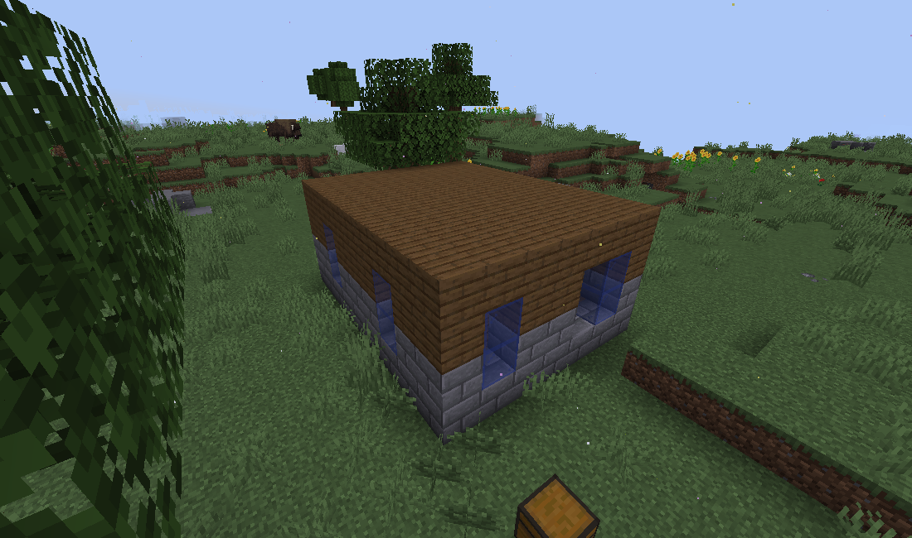

# M7-A 三维住宅验收

验收使用 Minecraft 1.20.1、Forge 47.4.20 和 387 个 BMC4 模组的合成独立副本。住宅沿用 `Building`、Blender、经过玩家批准的施工区与供料箱，以及 M2 的版本审阅机制。

## 实景设计

| 候选 | 占地与方块数 | 审阅内容 |
| --- | --- | --- |
| 紧凑小屋 | 7×7，153 块 | 偏侧门洞、紧凑窗组、单格前檐和长凳 |
| 主方案 V1 | 7×9，183 块 | 北向正面、成对透明窗、云杉平屋顶、长凳和石桌台 |
| 改图 V2 | 7×9，183 块 | 全部窗改用蓝色染色玻璃，保留其他布局和用料 |

两份初稿来自游戏内的不同自然语言请求。按建筑局部坐标比较，有 64 个位置只出现在其中一份方案里。Codex 接收 NPC 第一人称画面、相对地形和 Forge 核对过的地基选项。主方案的模型指出现场树冠、低坡与开阔草地，再据此选择正面方向和成对窗组。实测初稿的解释把门洞左右用了不同的观察方向。提示词已统一为站在屋内面朝正门向外看。同一帧的脱敏离线复测给出了与理由一致的东侧门洞。离线复测只用于核对解释规则，游戏里的 V1 和 V2 均绑定各自已经审阅的几何布局。

预览流程从 Forge 审阅报告复原方块 ID、相对坐标和完整状态，逐项与生成的 `Building` 对照。每份候选保存可打开的 `revision-review.blend`、两角度外观和室内剖视。剖视保留实际地板、墙体和家具的方块状态。

## 真实施工和恢复

授权测试客户端在原生 Minecraft 聊天中提交两份初稿，并用同一个测试玩家身份批准主方案。施工前用原生交互清理占地内八株草和两处矮灌木，并备好原版供料箱。勘察时有一株边缘草在尚无施工任务时消失。验收副本随后关闭生物改变方块的规则并重新记录基线。树木、坡地、已有方块和施工范围外均由读回检查。

V1 在第 68 块暂停，已经铺好完整地板并放上了两块透明玻璃。模型将玩家换窗指令解释为玻璃材质改动。首次审阅保留 66 块、拆换 2 块，有一处补建因邻接高草被判定为冲突。修正将例外限定于批准区域内、已有有效垂直支撑的原版草和高草的水平邻接。修正前保存停工状态，重开后重新审阅同一候选，并核对这处高草的完整状态。

副本重开后，原 NPC、背包、供料箱和 68 块已建结构与检查点一致。重新审阅的 V2 保留 66 块、补建 115 块、替换 2 块，冲突为 0。测试玩家按新哈希批准，同一个 NPC 继续施工。旧确认被 Forge 拒绝。

两个版本合计进行了 13 次供料运输。每笔均记录箱子的扣减和 NPC 的等量入库。游戏记录了 185 次原生放置与 2 次原生破坏，最远交互距离约 4.496 格。两次破坏各消耗 1 点镐耐久。V2 的完整屋顶由受支撑的边缘向内铺设。

完工逐块回读匹配全部 183 格及其完整状态。成品含 117 块云杉木板、48 块石砖、16 块蓝色染色玻璃和 2 块橡木台阶。门洞和室内共 33 格连通净空。共核验 5,613 格非目标位置，其中 1,806 格位于批准范围外，非预期变化均为 0。邻接高草的状态保持一致。

再次正常保存并重开后，成品、原 NPC、审批版本、行动记录、箱内数量和 NPC 背包均与保存前一致。各物品的原始入箱数量等于箱内余量、NPC 余量与实际放置消耗之和。测试玩家能站在屋内。此次验收前后，四份正式存档和原 BMC4 模组目录的逐文件校验一致。

[完整施工与收支证据](m7-a-evidence/house-construction.json) · [完工方案室内剖视](m7-a-evidence/revision-proposed-interior.png) · [7×7 前檐方案](m7-a-evidence/alternate-proposed.png) · [主方案施工前的 NPC 画面](m7-a-evidence/initial-npc-view.png)

## 模型与回归

使用 ChatGPT 认证的官方 Codex SDK，实际模型为 `gpt-6.2-sol`，推理深度为 `medium`。四轮合计 55,330 Tokens，包含三次图片发送，其中一次复用主方案的画面核对方位。SDK 使用只读沙箱，沙箱网络关闭，审批策略为 `never`。

| 回合 | 用途 | 耗时 | Tokens |
| --- | --- | ---: | ---: |
| 1 | 7×7 小屋实景设计 | 16.588 秒 | 14,286 |
| 2 | 7×9 住宅实景设计 | 15.230 秒 | 14,361 |
| 3 | 施工中自然语言换窗 | 9.749 秒 | 12,288 |
| 4 | 同一画面的左右视角复测 | 15.729 秒 | 14,395 |

51 项 Python 单测、Forge 离线构建、最小 Forge 的 M2 增量拆换与重开、M3 确定性后端的聊天审批和真实施工回归均通过。M3 回归分别检测相邻楼梯保护，以及测试玩家放置方块导致旧审阅失效的场景。

## 当前支持范围

- 单层住宅的宽和深各选 7 或 9 格。生成器支持石砌支脚、组合门洞和窗组、平屋顶或单格前檐、两格净高的房间及基础家具。此次生存施工搭建的是平屋顶住宅。前檐和尺寸差异在另一份实景候选中完成生成和预览。
- 地基支脚用于通过 Forge 校验的一格低洼。此功能有生成与边界测试。本次住宅使用自然同高的承重地面，实际支脚数为 0。
- 入口目前是门洞。挂门、楼层、多房间布局和人字屋顶属于后续能力。扩大已勘察占地需要重新勘察。

[启动和体验指南](m7-a-guide.md)
