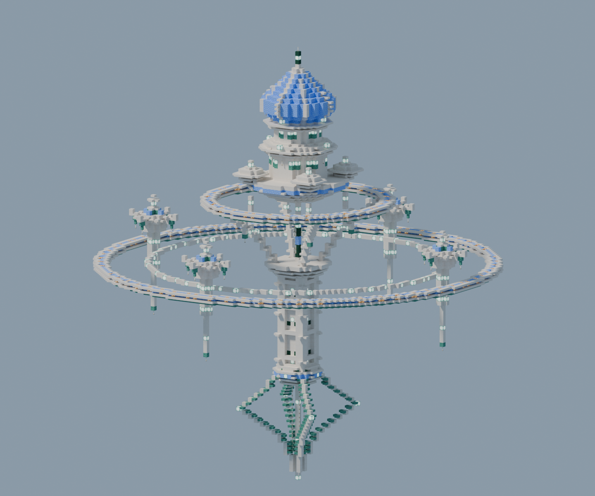

# 天空即为极限 · Minecraft 视频视觉复刻

根据夜言-碎雨的建筑视频重建。原视频使用 Java 1.17.1、原版材质与 BSL。本项目用 BMC4 的 Minecraft 1.20.1 方块资源和 Blender Cycles 重建可观察的建筑结构。[原作视频](https://www.bilibili.com/video/BV11U4y127EJ/)



## 当前版本

- 尺寸为 **95 × 103 × 95 格**（X × Y × Z），共 **8,990 格、12 种方块**。下层两环中心线半径 35、46 格，嵌带设在 Y=45。上环中心线半径 21 格，嵌带设在 Y=60。塔尖高至 Y=96，菱饰下端到 Y=−6。
- 下层保留三处相互分离的体量。双环之间是四座悬挂花亭，内环围着中央塔身。四条上行斜承托从中央接到上环。主塔上方是分瓣冰蓝穹顶，下方是带尖角灯的镂空菱饰。
- [设计源码](design.py) · [蓝图](building.json) · [机位与剖面](views.json) · [材料表](materials.csv) · [Blender 重开验证](fidelity/verification.json)
- [封面同机位](fidelity/reference-cover.png) · [环廊俯视](fidelity/reference-plan.png) · [花亭近景](fidelity/reference-satellite.png) · [参考约束与独立复验](fidelity/review.md)

在仓库根目录重生成蓝图、真实材料索引、代表成图和嵌贴图 Blender 工程。

```powershell
$py = 'C:/ProgramData/anaconda3/python.exe'
$env:MCBUILDER_INSTANCE = 'C:/Users/YOUNG/Desktop/PCL2-214-Test/.minecraft/versions/BMC4'
& $py -B -m src build --sample sky_limit_replica --preset final --view hero --cpu
& $py -B -m src open --sample sky_limit_replica --preset final
```

工程与成图在 `previews/sky_limit_replica/final/`。时间轴标记绑定机位，Scenes 菜单可切到下层剖面。对照图和对应的渲染记录位于 `fidelity/`。本项目的环和花亭之间有意留空，空间按创意飞行观赏。

## 上一版归档

[增强前版本](versions/final/) 保存了源码、蓝图、材料、机位和关键图。当时的 105 × 108 × 105 格版本共 11,280 格，完整图集和复验在 [final](final/) 中。[首次草案](versions/baseline/) 及 [上一轮评审](critic-verification.md) 也保留。原有 `walk-*.json` 使用上一版蓝图哈希，记录的是当时带水平斜桥的步行路线。[上一轮对照](comparison/)

本轮使用实际保存的封面和施工缩略帧。背面遮蔽处、上环细部接缝和灯点逐格分布仍有不确定性。封面未拍全菱饰尾部，施工缩略帧只支持整体轮廓。材质使用 BMC4 贴图和动画首帧，Blender 与原作 BSL 的色温及发光效果会有差异。
