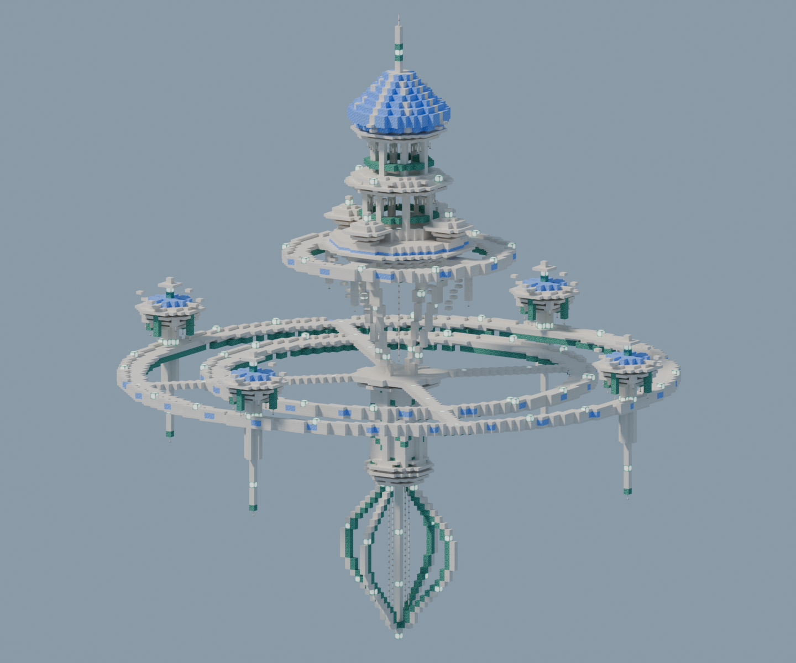

# 天空即为极限 · Minecraft 视频视觉复刻

参考：[夜言-碎雨《天空即为极限！》](https://www.bilibili.com/video/BV11U4y127EJ/)。本作是依据封面与教程施工缩略帧重新编写的方块设计，不是作者原存档，也不保证逐块一致。原视频标注 Java 1.17.1、原版材质、BSL；此交付使用本机 BMC4 的 Minecraft 1.20.1 方块资源和 Blender Cycles。



## 成品

- 尺寸 **105 × 108 × 105 格**（X × Y × Z），共 **11,280 格、8 种方块 ID**。
- 下层双圆环、四向斜桥、四座悬挂灯亭；上层小圆环与白色灯塔；冰蓝穹顶；下方四面镂空菱形垂饰。
- 下层环廊标高 Y=45，上环 Y=66，主塔露台 Y=69，尖顶最高 Y=107。
- 坐标原点是最下端中央针饰，X 东、Z 南。建筑在空中展示，未附加地基或无关景观。

## 文件与使用

- `design.py`：可重生成的 Python 自由建模源码，使用现有 `src.core.building.Building`。
- `building.json`：逐格方块和状态蓝图，可供当前 MC AI Builder 读取；它不是 `.schem` 或世界存档。
- `views.json`：9 个机位和下层平面剖切；`design-groups.json`：按建筑部件组织。
- `materials.csv`、`material-index.json`：实际 BMC4 安装资源校验和材料数量。
- 最终图与嵌贴图 Blender 工程位于仓库 `previews/sky_limit_replica/final/`；交付副本放在同名 `final/` 目录。
- Git 归档在本项目 `final/` 中保留全部 9 张成图和复验记录，`comparison/` 保留同机位前后对照；嵌贴图 `.blend` 保留在本机交付包，可用下方命令重生成。
- Blender 工程可直接打开查看；时间轴标记绑定机位，选标记所在帧后按小键盘 0。Scenes 可切换下层平面剖切，Outliner 可按部件查看。

在 `D:/MC-AI-Builder` 重生成：

```powershell
& C:/ProgramData/anaconda3/python.exe -B -m src build --sample sky_limit_replica --instance C:/Users/YOUNG/Desktop/PCL2-214-Test/.minecraft/versions/BMC4 --preset final --cpu
```

## 实际审阅与选择

参考实图留在 `references/`。从施工俯视图确定同心圆环和四条斜向连接，从全景确定上环、细塔与下挂菱形的关系。选材拼图使用本机贴图，保留原作的石英白、浮冰蓝、海晶石绿与灯点，没有为使用模组而改变原作配色。

首稿冻结于 `versions/baseline/`。未参与设计的独立 Critic 先对照参考与真实渲染形成初判，之后用固定机位前后图复验。中心粗绿柱束改为细末地烛，圆环改为白色细檐与间隔蓝色嵌块，补充檐下托斗和分离垂瓣。修订从 13,196 格降至 11,280 格。原始初判与复验见 `critic-baseline.md` 和 `critic-verification.md`；同机位差异在仓库 `previews/sky_limit_replica/comparison/`。

已验证四条中心→斜桥→外环路线，每条 65 步；另验证中心到东、西、南、北灯亭旁环廊，每条 101 步。`walk-*.json` 保存蓝图哈希、端点及路径坐标。此结论仅针对下层铺面连通，不能推导上下悬浮层步行相通；跨层按创意飞行观赏。护栏为原作气质的低薄檐，不作为生存防坠落设施。

最终工程已由 Blender 5.2.4 重新打开并通过现有 `final` 复验：全建筑覆盖 11,280 格，2 个场景、9 个相机标记可切换、9 张 Minecraft 贴图已嵌入，9 张 1440×1200 PNG 均成功解码。结果见 `final/verification.json`，输入哈希与出图记录见 `final/render.json`。最终全景、完整俯视、灯亭及下层平面已实图检查。

## 表现边界

封面和教程缩略帧不足以逐格确认背面、隐藏接缝和全部构件，灯亭分瓣与原作仍有差异。塔内为镂空灯塔空间，没有扩展成住宅。海晶石和海晶灯使用动画首帧；Cycles 的环境、灯光与原视频 BSL 不同。本轮没有在运行中的 Minecraft 世界内放置或验证建筑，也未改动已有存档。
